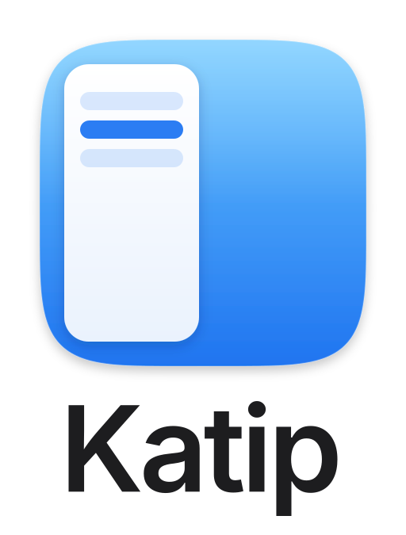

<p align="center">
  <picture>
    <source media="(prefers-color-scheme: dark)" srcset="assets/brand/logo-dark.svg">
    
  </picture>
</p>

<p align="center">
  <strong>Chromium ブラウザのサイドパネルで使う、縦型タブと Space</strong>
</p>

<p align="center">
  <a href="README.md">English</a> | <strong>日本語</strong>
</p>

Katip は、Chromium 系ブラウザ（Chrome、Brave、Edge など）のサイドパネルを  
使いやすく美しいサイドバーに変えるオープンソース拡張機能です。

増えすぎたタブを用途ごとの「Space」にすっきり整理し、開きたいページやコマンドを瞬時に呼び出せます。  
外部サーバーを介さない完全オフライン設計で、データがブラウザの外に出ることはありません。

## 主な機能

- **スペース**  
  仕事やプライベートなど用途に合わせてタブとテーマカラーを分離できます。

- **ピン留めとフォルダ**  
  よく使うページをピン留めできます、ブラウザ標準のブックマークとも同期されます。

- **分割ビュー**  
  タブを重ねてドラッグするだけで、2 つのページを並べて同時に閲覧できます。

- **お気に入り**  
  どのウィンドウや Space からでも、よく使うページへ即座にアクセスできます。

- **コマンドパレットからの検索・コマンド**  
  開いているタブ、ピン留め、閲覧履歴、Web、ショートカットコマンドを1つのコマンドパレットからまとめて高速検索できます。

- **ライブフォルダ**  
  Gmail の新着や GitHub の PR・Issue をサイドバーからリアルタイムで確認できます。

- **Arc Browser からのワンクリック移行**  
  Arc Browserの設定ファイルを読み込むことでスペースやピン留め環境をそのまま移行できます。

## Arc Browser からの移行

Arc Browser のサイドバー設定ファイルを指定するだけで、Space、テーマカラー、ピン留め、フォルダをそのまま移行できます。

1. Katip の設定画面から **データ → Arc から移行** を開きます。
2. 以下のパスにある設定ファイルを選択してインポートします：
   - **macOS**: `~/Library/Application Support/Arc/StorableSidebar.json`
   - **Windows**: `%LOCALAPPDATA%\Packages\TheBrowserCompany.Arc_…\LocalCache\Local\Arc\`

※ 既存の Katip データに追加される形でインポートされ、上書きや削除はされません。  
ファイルは端末内でのみ安全に処理されます。

## プライバシー

Katip は外部サーバーを持たず、プライバシーを最優先に設計されています：

- 外部サーバーとの通信は一切ありません（テレメトリやトラッキングも完全ゼロ）。
- データはすべてブラウザ内部のストレージおよびブックマークに安全に保存されます。
- ライブフォルダは、許可したサイト（Gmail・GitHub）の公式 API とブラウザから直接通信します。
- 詳しくは [プライバシーポリシー](PRIVACY.md) をご覧ください。

## インストール

サイドパネルに対応した Chromium 系ブラウザ（Chrome 120 以降、Brave、Edge など）で動作します。

- **Chrome ウェブストア**: 近日公開予定
- **GitHub Releases から**: [Releases](https://github.com/qaynam/Katip/releases) から最新の `katip-<version>.zip` をダウンロードして解凍します。拡張機能の管理画面（`chrome://extensions` など）で「デベロッパー モード」を有効にし、**パッケージ化されていない拡張機能を読み込む** から解凍フォルダを選択してください。

### アップデート

新しいリリースの zip を解凍し、同じ手順で読み込むだけで完了します。  
※ 古いバージョンを削除すると保存データが消去されてしまうため、削除せずにそのまま読み込んでください。

### パッケージの真正性確認

GitHub CLI で公式ワークフローからビルドされた zip であることを検証できます：

```sh
gh attestation verify katip-<version>.zip --repo qaynam/Katip
```

## 開発・ビルド

動作要件: Node.js 24、pnpm 11

```sh
pnpm install
pnpm dev        # 変更を監視して apps/extension/dist/ を自動ビルド
```

拡張機能の管理画面で「パッケージ化されていない拡張機能を読み込む」から `apps/extension/dist/` を読み込みます。

| コマンド        | 内容                                                 |
| --------------- | ---------------------------------------------------- |
| `pnpm dev`      | 開発用ビルドとファイル監視（`apps/extension/dist/`） |
| `pnpm check`    | 型チェック、Lint、フォーマット検証、テストを一括実行 |
| `pnpm test`     | 単体・統合テストの実行（Vitest）                     |
| `pnpm test:e2e` | 実機 Chromium での E2E テスト（Playwright）          |
| `pnpm package`  | 配布用 zip の作成（`apps/extension/.release/`）      |

## アーキテクチャ概要

- **Single Writer**: UI（Svelte）は状態を直接変更せず、型付けされたコマンドを Background ワーカーへ送信。Background が順次処理し、最新の表示状態を各画面へ配信します。
- **純粋なドメインロジック**: `src/modules/` 配下はブラウザ API から完全に切り離されており、Effect サービスと純粋関数で構成されています。
- **ストレージ**: ピン留めやフォルダはブラウザ標準のブックマークとして保存され、自動で同期されます。その他の設定はブラウザのローカルストレージを使用します。

## ライセンス

[MIT ライセンス](LICENSE)
