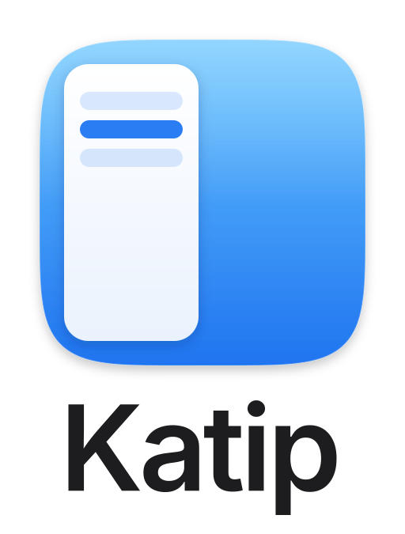
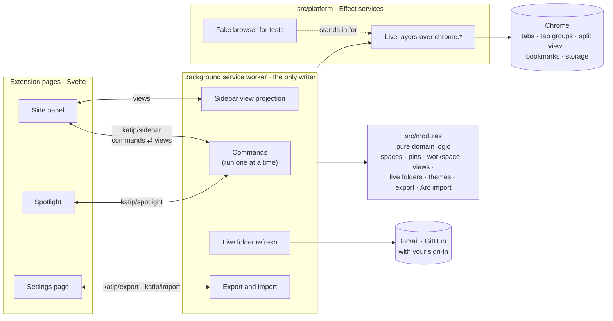
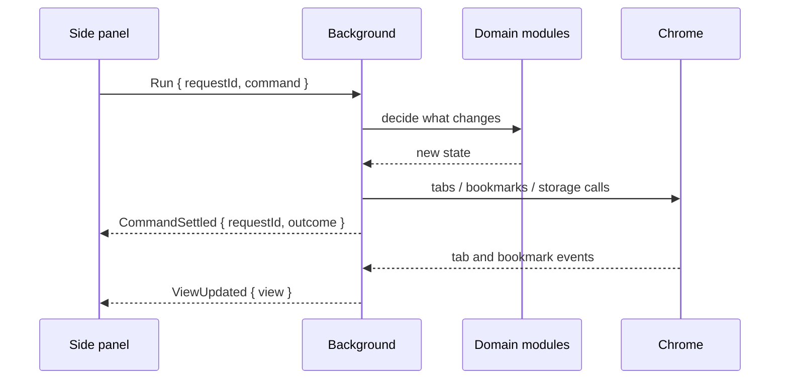

<p align="center">
  <picture>
    <source media="(prefers-color-scheme: dark)" srcset="assets/brand/logo-dark.svg">
    
  </picture>
</p>

<p align="center">Vertical tabs, Spaces and pinned tabs in Chrome's side panel.</p>

Katip turns Chrome's side panel into a sidebar that organizes your tabs into Spaces. Each Space keeps its own pinned tabs and folders, its open tabs, and its own colors. Everything stays in your browser.

## Features

- **Spaces**: separate sets of tabs for work, hobbies or projects, each with its own gradient theme. Switch with the dock at the bottom of the side panel.
- **Pinned tabs and folders**: pins are saved as Chrome bookmarks, so Chrome Sync carries them to your other devices. Nest folders, give them icons, and drag anything anywhere.
- **Split view**: drop one tab onto another to open them side by side, and pin the pair to reopen it later (Chrome 155 or later).
- **Favorites**: Chrome's pinned tabs, shown as a row of icons at the top.
- **Live folders**: a folder that lists your Gmail inbox or label, or your GitHub review requests, pull requests, issues or mentions, using the session you're already signed in with.
- **Spotlight**: one search box for open tabs, pins, Spaces, history and the web, plus commands such as "Copy URL", "Pin tab" or "Move to Space". Press Tab on an empty box to search commands only.
- **Archive**: temporary tabs you haven't used for a while are closed and kept in the archive, so you can bring them back.
- **Keyboard shortcuts**: open the side panel, Spotlight, and copy the current URL or a Markdown link. Assign your own keys at `chrome://extensions/shortcuts`.
- **Import and export**: export everything to a versioned JSON file, import it again, or move over from Arc (see below).
- **Languages**: English, Japanese, Simplified Chinese and Spanish.

## Moving from Arc

Arc keeps its sidebar in a file on your computer. In Katip's settings, open **Data → Import from Arc**, choose that file, check the preview, and import:

- macOS: `~/Library/Application Support/Arc/StorableSidebar.json` (press ⌘⇧G in the file dialog to paste the path)
- Windows: under `%LOCALAPPDATA%\Packages\TheBrowserCompany.Arc_…\LocalCache\Local\Arc\`

Katip brings over your Spaces, their colors, pinned tabs, folders, split views and Favorites. It only adds; nothing you already have in Katip is changed or removed. The file is read inside your browser and never sent anywhere.

## Privacy

Katip has no server and sends nothing anywhere. Your Spaces, pins and settings live in Chrome's own storage and bookmarks. Live folders talk directly to Gmail and GitHub from your browser, using your existing sign-in, and only after you allow access to that site. Reading your history for Spotlight is optional and asks for permission first. See the [privacy policy](PRIVACY.md) for the details.

## Install

- **Chrome Web Store**: coming soon.
- **From a release**: download `katip-<version>.zip` from [Releases](https://github.com/qaynam/Katip/releases), unzip it, open `chrome://extensions`, turn on Developer mode, and choose **Load unpacked**.
- **From source**: see Development below.

Katip runs on Chrome 120 or later and on other Chromium browsers with a side panel.

## Development

Requirements: Node.js 24 and pnpm 11.

```sh
pnpm install
pnpm dev        # rebuilds apps/extension/dist/ on every change; the loaded extension reloads itself
```

Then open `chrome://extensions`, turn on Developer mode, choose **Load unpacked**, and select `apps/extension/dist/`. The development build is named "Katip (dev)".

| Command                                       | What it does                                                               |
| --------------------------------------------- | -------------------------------------------------------------------------- |
| `pnpm dev`                                    | Watch build of the development extension into `apps/extension/dist/`       |
| `pnpm check`                                  | Type check, lint, format check and unit tests                              |
| `pnpm test`                                   | Unit and integration tests (Vitest)                                        |
| `pnpm test:e2e`                               | End-to-end tests in a real Chromium (Playwright)                           |
| `pnpm package`                                | Production build zipped into `apps/extension/.release/katip-<version>.zip` |
| `node apps/extension/scripts/render-brand.ts` | Regenerate the brand SVGs and PNGs, and the extension icons                |

### Tests

Tests come in three layers:

1. **Unit and integration tests** (`pnpm test`) run the real background, side panel and Spotlight code against a fake browser in `apps/extension/src/platform/browser-testing/`. They are fast and cover most behavior.
2. **Browser contract tests** keep that fake honest. The same scenarios in `apps/extension/src/platform/browser-contract/` run against the fake in Vitest and against real Chrome in Playwright, so any difference between the fake and Chrome fails a test.
3. **End-to-end tests** (`pnpm test:e2e`) load the production build into a real Chromium and drive the side panel, Spotlight and settings page.

End-to-end tests need a full Chromium that accepts `--load-extension`. Google Chrome 137 and later no longer does, so point `KATIP_E2E_CHROME` at [Chrome for Testing](https://googlechromelabs.github.io/chrome-for-testing/) or another Chromium build:

```sh
KATIP_E2E_CHROME="/path/to/Google Chrome for Testing" pnpm test:e2e
```

CI runs the suite on the stable channel and on Chrome 149, which has no split view.

## Architecture



Paths in this section are under `apps/extension/`.

- **The background is the only writer.** Pages never change Chrome or storage themselves. They send commands over a port (`src/protocol/` defines every message with Effect Schema), and the background runs them one at a time, then publishes a fresh view of each window to the pages that subscribe to it.
- **Domain logic is pure.** `src/modules/` holds the rules (how tabs join Spaces, how pins map to bookmarks, how a view is projected, the export file format) as plain functions and Effect services with no direct `chrome.*` access. Each module exposes one entry point, imported as `#modules/<name>`.
- **Chrome sits behind services.** `src/platform/` wraps each Chrome API in an Effect service with a live layer and a fake, which is what lets the whole background run in tests. The browser contract tests check that the two behave the same.
- **Where data lives.** Pinned tabs and folders are bookmarks under a "Katip" folder, so Chrome Sync carries them. Settings are in `storage.sync`, Spaces and per-folder details in `storage.local`, and which tab belongs to which Space in `storage.session`.

A command from the side panel, end to end:



### Layout

The repository is a pnpm workspace run with Turborepo; the commands above work from the root.

```text
apps/
  extension/      the Chrome extension
    src/
      apps/       entry points: background, sidepanel, spotlight, options, offscreen, dev-harness
      modules/    domain logic, one directory per module
      platform/   Chrome API services, the fake browser and the browser contract
      protocol/   messages between pages and the background
    e2e/          Playwright tests and the contract test runner
    scripts/      packaging, brand assets and store screenshots
    store/        Chrome Web Store listing, screenshots and promo images
  web/            the website, in English and Japanese (Astro, served by a Cloudflare Worker)
    src/          pages, components and the copy of both languages in copy/
    worker/       the Worker that sends visitors at / to their language
assets/brand/     icon, logos and wordmark as SVG, with PNGs in png/
```

### Website

`apps/web/` is a static site with no client-side JavaScript. It takes its screenshots from `apps/extension/store/`, its logos from `assets/brand/` and its privacy policy pages from `PRIVACY.md` at build time, so updating those updates the site. All text lives in `apps/web/src/copy/`.

```sh
pnpm dev:web      # the site at http://localhost:4321, without the Worker
pnpm preview:web  # builds, then serves the site with the Worker at http://localhost:8787
pnpm deploy:web   # builds and deploys to Cloudflare
```

It is deployed as a Cloudflare Worker with static assets (`apps/web/wrangler.jsonc`). The Worker runs only for `/`, redirecting to the language the browser's `Accept-Language` ranks highest; when that names neither English nor Japanese, visitors from Japan go to `/ja/` and everyone else to `/en/`. Every other path is served straight from the build. The site lives at [katip.qaynam.dev](https://katip.qaynam.dev): `pnpm deploy:web` attaches that custom domain to the `katip-web` Worker, which needs the `qaynam.dev` zone in the same Cloudflare account. Before the first deploy, run `pnpm --filter @katip/web exec wrangler login` (or set `CLOUDFLARE_API_TOKEN` and `CLOUDFLARE_ACCOUNT_ID`). If the domain changes, change both `SITE_URL` in `apps/web/src/site.ts` and the route in `apps/web/wrangler.jsonc`. Once the store listing is published, set `CHROME_WEB_STORE_URL` in the same file to show "Add to Chrome".

## Brand assets

`assets/brand/` holds the icon and logos as SVG, with PNG exports in several sizes in `assets/brand/png/`. The `-dark` files are for dark backgrounds.

| File                                              | Use                                                   |
| ------------------------------------------------- | ----------------------------------------------------- |
| `icon.svg`                                        | The app icon on the macOS icon grid                   |
| `icon-small.svg`                                  | The icon for 16 and 32 px, without margin or tab rows |
| `logo.svg`, `logo-dark.svg`                       | Icon above the name                                   |
| `logo-horizontal.svg`, `logo-horizontal-dark.svg` | Icon beside the name                                  |
| `wordmark.svg`, `wordmark-dark.svg`               | The name alone, in Inter SemiBold as outlines         |

They are generated by `apps/extension/scripts/render-brand.ts` from `apps/extension/scripts/brand/`; edit those and run the script rather than editing the files by hand.

## Contributing

Issues and pull requests are welcome. A few conventions keep the code easy to follow:

- Code says **how**, tests say **what** (test names read as behavior), commit messages say **why**, and code comments say **why not** (why the obvious alternative wasn't taken).
- Write code, comments, tests and commit messages in English. User-facing text goes into the translation catalogs in `apps/extension/src/modules/i18n/catalogs/`.
- Run `pnpm check` before opening a pull request, and `pnpm test:e2e` when you touch browser behavior.

## Releasing

Set the version in `apps/extension/package.json` (the manifest takes it from there), then push a tag:

```sh
git tag v0.1.0
git push origin v0.1.0
```

CI checks that the tag matches the version, runs every check, and creates a GitHub Release with the zip ready for the Chrome Web Store.

## License

The code is released under the [MIT License](LICENSE).

The Katip name and logo are not covered by the license. You're welcome to fork and build on the code, but please give your version its own name and icon.
