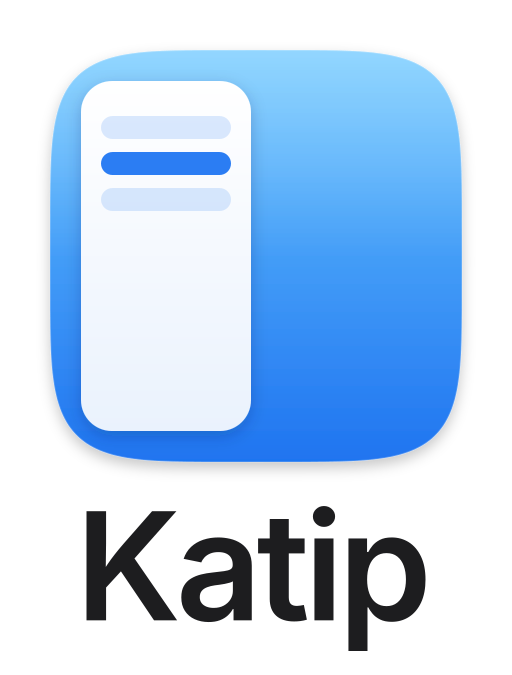

<p align="center">
  <picture>
    <source media="(prefers-color-scheme: dark)" srcset="assets/brand/logo-dark.svg">
    
  </picture>
</p>

<p align="center">
  <strong>Vertical tabs, Spaces, and smart tab organization in the Chromium side panel.</strong>
</p>

<p align="center">
  <strong>English</strong> | <a href="README.ja.md">日本語</a>
</p>

Katip transforms the side panel of Chromium-based browsers (Chrome, Brave, Edge, etc.) into a clean, intuitive sidebar. Organize your tabs into Spaces, pin your essentials, and find anything instantly with Spotlight—all with zero tracking and full offline privacy.

## Features

- **Spaces**: Separate workspaces for projects, work, or personal browsing, each with its own gradient theme. Switch instantly from the dock at the bottom.
- **Pinned Tabs & Folders**: Pinned items save directly as browser bookmarks for automatic sync. Create nested folders and customize folder icons.
- **Split View**: Drag and drop tabs onto each other to view pages side by side.
- **Favorites**: A persistent top row of quick-launch icons accessible across all windows and Spaces.
- **Spotlight**: A lightning-fast search palette for open tabs, bookmarks, history, web search, and custom commands.
- **Live Folders**: Dynamic folders that surface your unread Gmail messages or GitHub PRs and issues right inside your sidebar.
- **Arc Import**: Migrate your Spaces, colors, pins, and folders from Arc in a single click.

## Moving from Arc

Katip can import your sidebar setup directly from Arc's local configuration file:

1. In Katip settings, go to **Data → Import from Arc**.
2. Select your file and import:
   - **macOS**: `~/Library/Application Support/Arc/StorableSidebar.json`
   - **Windows**: `%LOCALAPPDATA%\Packages\TheBrowserCompany.Arc_…\LocalCache\Local\Arc\`

Your data is read locally in your browser and never sent anywhere. Existing Katip items are preserved.

## Privacy

Katip is serverless and private by design:

- No external Katip servers, telemetry, or tracking.
- Spaces, pins, and settings live securely in your browser's local storage and bookmarks.
- Live Folders communicate directly with Gmail and GitHub only with your permission.
- See the [Privacy Policy](PRIVACY.md) for full details.

## Installation

Runs on Chromium-based browsers with side panel support (Chrome 120+, Brave, Edge, etc.).

- **Chrome Web Store**: Coming soon.
- **From GitHub Releases**: Download `katip-<version>.zip` from [Releases](https://github.com/qaynam/Katip/releases), unzip it, open `chrome://extensions`, enable **Developer mode**, and select **Load unpacked**.

### Updating

Unzip the new release and load it the same way. Every release shares a consistent extension ID, so your data and settings are preserved. Do not remove the old version before updating, as removal clears stored data.

### Verification

Verify release packages with the GitHub CLI:

```sh
gh attestation verify katip-<version>.zip --repo qaynam/Katip
```

## Development

Requirements: Node.js 24 and pnpm 11.

```sh
pnpm install
pnpm dev        # Watches and rebuilds apps/extension/dist/
```

Load `apps/extension/dist/` as an unpacked extension in Developer mode.

| Command         | Description                                                      |
| --------------- | ---------------------------------------------------------------- |
| `pnpm dev`      | Starts watch build for the extension into `apps/extension/dist/` |
| `pnpm check`    | Runs type checking, linting, formatting checks, and unit tests   |
| `pnpm test`     | Runs unit and integration tests (Vitest)                         |
| `pnpm test:e2e` | Runs end-to-end tests in real Chromium (Playwright)              |
| `pnpm package`  | Builds production package zipped into `apps/extension/.release/` |

## Architecture Overview

- **Single Writer**: UI pages (Svelte) dispatch typed commands to the background service worker, which serially executes them and pushes updated state back to subscribers.
- **Pure Domain Logic**: `src/modules/` encapsulates all core logic using pure functions and Effect services, decoupled from browser APIs.
- **Storage**: Pins and folders are stored as native bookmarks for seamless sync. Other preferences reside in local browser storage.

## License

Released under the [MIT License](LICENSE).  
_The Katip name, logo, and brand icons are trademarks. When creating a fork, please use your own distinct name and icon._
